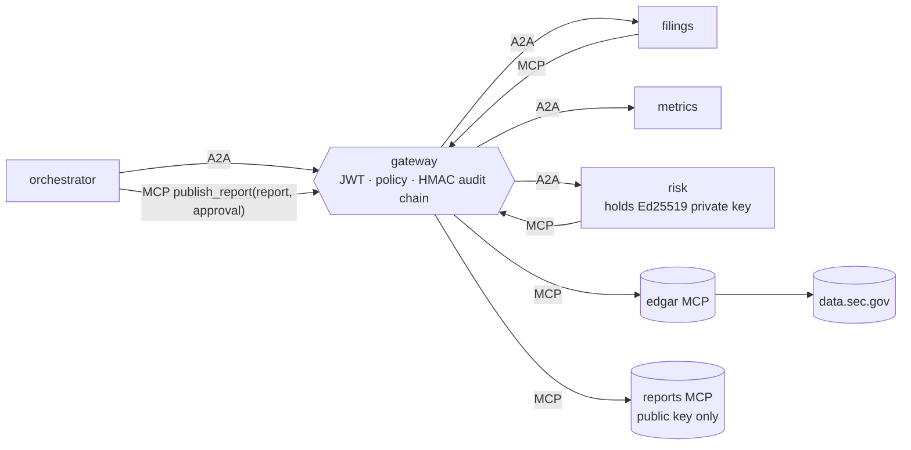

# gs-filings-audit

Auditable financial agents. One agent pulls public **SEC EDGAR** data over MCP,
another computes metrics with per-number lineage, and a **risk agent must sign
an approval** before any report is released. The gateway enforces what each
agent can reach and writes every call to a **tamper-evident audit log**. Aimed
at the Goldman Sachs Tech Summer Analyst role, where controls and auditability
matter as much as the AI.

Built on [`agent-mesh-core`](../agent-mesh-core).



## Controls

| Control | Mechanism |
|---|---|
| Segregation of duties | `metrics` has no data access, `risk` can re-read facts but never publish, and `orchestrator` can request publication but can't approve. All enforced by the gateway policy in `mesh.yaml` and tested. |
| Maker–checker | `risk` doesn't trust `metrics`. It re-fetches EDGAR facts itself, checks every input against them by period **and accession number**, and re-evaluates every formula with its own evaluator. |
| Release gate | `publish_report` accepts only an EdDSA JWT signed by the risk agent over the SHA-256 of the exact report. The reports server holds only the public key, so it can verify but not forge an approval. Altered reports, forged tokens and replays (persisted across restarts) are refused. |
| Lineage | Every metric lists its formula, its inputs and each input's XBRL concept, period end and filing accession number. |
| Data-quality checks | Completeness of the latest period, freshness (10-K within ~15 months), plausibility ranges, and restatement detection (a later 10-K changed a prior-year value). Restatements are warnings; the report uses the latest filing. |
| Audit trail | Every gateway call, allowed or denied, is hash-chained and HMAC-keyed (`AGENTMESH_AUDIT_KEY`), including request/response hashes. Check it with `agentmesh audit verify`, and count blocked calls with `agentmesh audit stats`. |

## Run it

```bash
uv venv -p 3.13 && uv pip install -e ../agent-mesh-core -e '.[dev]'
.venv/bin/pytest                         # 17 tests on a synthetic company

export AGENTMESH_SECRET=$(python -c "import secrets; print(secrets.token_urlsafe(48))")
export AGENTMESH_AUDIT_KEY=$(python -c "import secrets; print(secrets.token_urlsafe(32))")
export SEC_USER_AGENT="Your Name you@example.com"     # SEC requires a contact; max 10 req/s is enforced
.venv/bin/filingsaudit keygen                          # keys/risk_ed25519.pem (+ .pub.pem)
.venv/bin/agentmesh up mesh.yaml &
.venv/bin/filingsaudit analyze AAPL                    # APPROVED / REJECTED + checks + metrics with accessions
.venv/bin/filingsaudit verify reports/AAPL-*.json      # offline check of a published report's approval
.venv/bin/agentmesh audit verify audit/gateway.jsonl
.venv/bin/agentmesh audit stats audit/gateway.jsonl    # e.g. blocked unauthorized calls
curl -s localhost:8200/metrics                          # gateway overhead p50/p95/p99
```

`analyze` exits 2 when risk rejects, so it can gate a CI job.

## Numbers for the resume, and where they come from

- **Gateway latency overhead:** `/metrics` → `gateway_overhead_ms` (auth + policy + filtering, excluding upstream time).
- **Blocked unauthorized calls:** `agentmesh audit stats` → `decisions.denied`, with the top denial reasons.
- **Tamper detection:** `tests/test_metrics_risk.py` shows each class of tampering (changed value, swapped accession, edited formula, dropped metric, stale data) caught by a named check.

## Status

All tests run against a synthetic EDGAR fixture (`tests/edgar_mock.py`: a
fictional company with comparatives, a restatement and quarterly noise). The
client hasn't yet run against live data.sec.gov, because sandbox network access
to `data.sec.gov`/`www.sec.gov` was pending during development. The first live
`analyze` run is the check. Some companies tag revenue differently; extend
`CONCEPTS` in `edgar.py` if a metric shows as missing.
